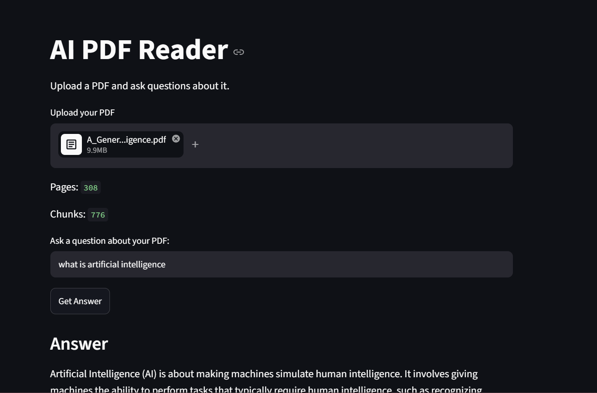
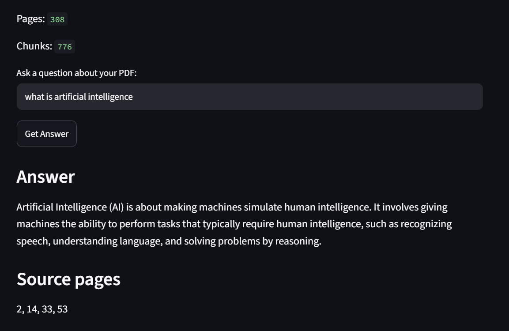

# AI PDF Reader — RAG Question Answering

An AI-powered PDF question-answering application developed using **Retrieval-Augmented Generation (RAG)**, LangChain, Ollama, ChromaDB, and Streamlit. It allows users to upload a PDF document and ask questions based on its content.

The application retrieves relevant text from the uploaded PDF and uses a locally running language model to generate answers with source-page references.

## Application Screenshots

### Question and Answer — Screenshot 1


### Question and Answer — Screenshot 2



## Features

- **PDF Upload:** Upload a PDF document through the Streamlit interface.
- **Text Extraction:** Extract text from PDF pages using PyPDF.
- **Text Chunking:** Split extracted text into smaller, overlapping chunks for retrieval.
- **Text Embeddings:** Generate vector embeddings using the Nomic Embed Text model.
- **Vector Database:** Store and search document chunks using ChromaDB.
- **Semantic Retrieval:** Retrieve relevant document passages for a user's question.
- **AI Question Answering:** Generate answers using the Qwen 2.5 1.5B model through Ollama.
- **Source References:** Display the PDF page numbers associated with retrieved answers.
- **Context-Based Responses:** Instruct the model to answer using the retrieved PDF content and indicate when the answer cannot be found.
- **Local Model Execution:** Run the language model and embedding model locally without requiring a paid LLM API key.

## Technologies Used

- Python 3.11
- Streamlit
- LangChain
- Ollama
- Qwen 2.5 1.5B
- Nomic Embed Text
- ChromaDB
- PyPDF

## How It Works

This project follows a Retrieval-Augmented Generation (RAG) workflow.

1. **Upload a PDF:** The user uploads a document through the application.
2. **Extract Text:** The application extracts text from each PDF page and keeps page metadata.
3. **Split into Chunks:** The extracted text is divided into smaller chunks using `RecursiveCharacterTextSplitter`.
4. **Generate Embeddings:** The Nomic Embed Text model converts the chunks into vector representations.
5. **Store Vectors:** ChromaDB stores the vectors and their associated document content and metadata.
6. **Retrieve Relevant Content:** When the user asks a question, the retriever searches for the four most relevant chunks.
7. **Generate an Answer:** The Qwen 2.5 1.5B model generates a response based on the retrieved context.
8. **Show Sources:** The application displays the answer and relevant source-page references.

## Project Structure

```text
AI_PDF_Reader/
├── app.py
├── README.md
├── .gitignore
├── .python-version
├── pyproject.toml
└── uv.lock
```

## Requirements

- Python 3.11
- Ollama
- The Qwen 2.5 1.5B model
- The Nomic Embed Text model
- The Python dependencies listed in `pyproject.toml`

## Setup and Installation

### 1. Install Ollama

Download and install Ollama from:

https://ollama.com/

### 2. Download the Required Models

```bash
ollama pull qwen2.5:1.5b
ollama pull nomic-embed-text
```

### 3. Clone the Repository

```bash
git clone https://github.com/sayanajoseph/AI_PDF_Reader.git
cd AI_PDF_Reader
```

### 4. Install Python Dependencies

```bash
python -m pip install streamlit pypdf langchain-core langchain-text-splitters langchain-ollama langchain-chroma chromadb
```

### 5. Run the Application

From the project directory, run:

```bash
python -m streamlit run app.py
```

```text
http://localhost:8501
```

Open the URL in your browser to use the application.

## Example Usage

1. Start the application.
2. Upload a text-based PDF document.
3. Enter a question about the document.
4. Read the generated answer.
5. Check the displayed source-page references.
6. Ask another question about the document.

If the requested information is not present in the retrieved PDF content, the application is instructed to respond that it could not find the answer in the uploaded PDF.

## Limitations

- Scanned PDFs containing images rather than extractable text are not supported by the current text-extraction workflow.
- Answer quality depends on the PDF's text, retrieval results, embedding model, and language model.
- The model may occasionally produce inaccurate answers, so verify important information against the original document.
- Running the models locally requires sufficient system memory and storage.
- The application uses local Ollama models and is designed for local use rather than hosted deployment.

## Future Improvements

- Add OCR support for scanned PDFs.
- Support multiple-document question answering.
- Add chat history and conversation controls.
- Improve retrieval quality and evaluate answer accuracy.
- Add document previews and more detailed source citations.
- Add configurable chunking and retrieval settings.

## Author

**Sayana Joseph**

Developed as an AI Engineer portfolio project to demonstrate practical skills in Python, LangChain, Retrieval-Augmented Generation, vector databases, local language models, and Streamlit application development.
